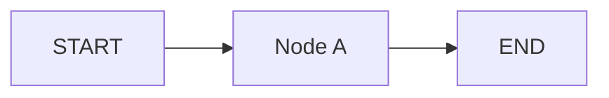
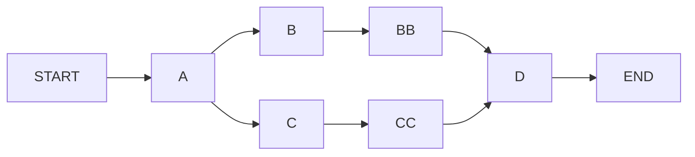
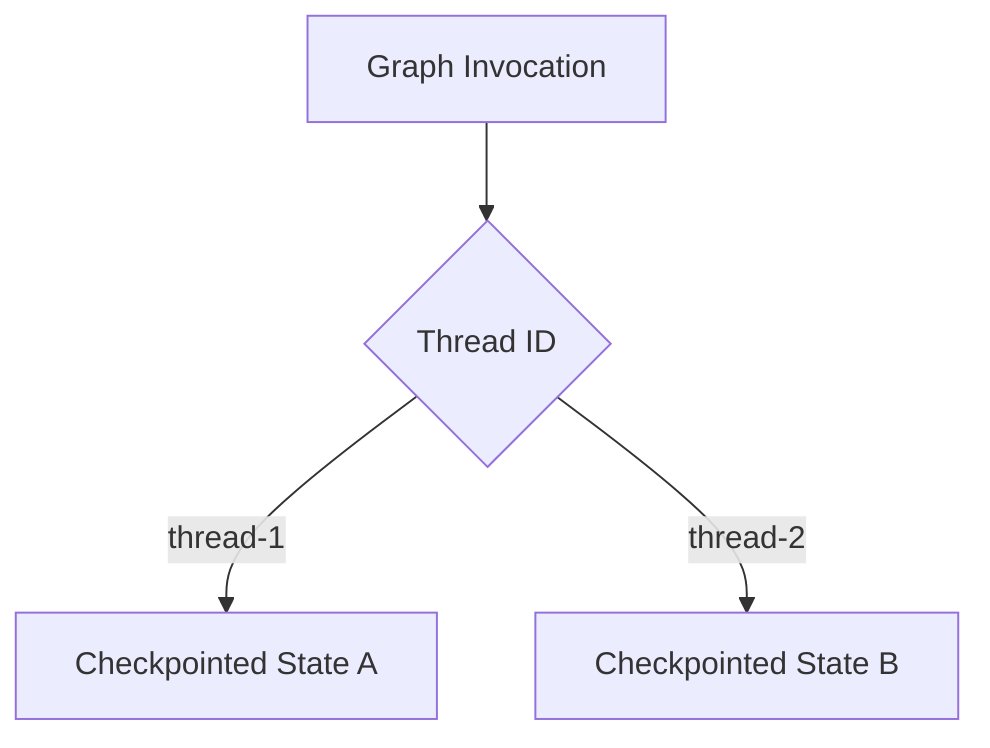
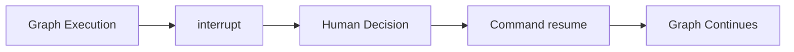
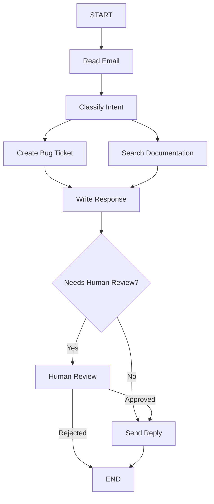

# LangGraph Essentials — TypeScript

A hands-on collection of LangGraph implementations created while completing [LangGraph Essentials — TypeScript](https://academy.langchain.com/courses/quickstart-langgraph-essentials-typescript) from LangChain Academy.

## What This Demonstrates

- LangGraph `StateGraph`
- Nodes and edges
- Shared graph state with Zod
- State reducers
- Parallel execution
- Conditional routing
- `Command`-based navigation
- Checkpointing and thread-based memory
- Interrupts and graph resumption
- Human-in-the-loop workflows
- Structured LLM output
- Multi-step AI workflow orchestration

## Learning Progression

<table>
  <thead>
    <tr>
      <th>Example</th>
      <th>What It Demonstrates</th>
    </tr>
  </thead>
  <tbody>
    <tr>
      <td><a href="01-simple-node.ts"><strong>01 — Simple Node</strong></a></td>
      <td>Creating a StateGraph, defining shared state, connecting START and END, compiling, and invoking a graph</td>
    </tr>
    <tr>
      <td><a href="02-parallel-execution.ts"><strong>02 — Parallel Execution</strong></a></td>
      <td>Branching into multiple nodes concurrently, joining execution paths, and combining state updates with reducers</td>
    </tr>
    <tr>
      <td><a href="03-conditional-edge.ts"><strong>03 — Conditional Routing with Command</strong></a></td>
      <td>Updating graph state and dynamically selecting the next node using LangGraph's Command API</td>
    </tr>
    <tr>
      <td><a href="04-conditional-router-edge.ts"><strong>04 — Conditional Edges</strong></a></td>
      <td>Separating routing logic from node execution with addConditionalEdges()</td>
    </tr>
    <tr>
      <td><a href="05-memory.ts"><strong>05 — Memory & Checkpointing</strong></a></td>
      <td>Persisting graph state with MemorySaver and maintaining independent state across thread IDs</td>
    </tr>
    <tr>
      <td><a href="06-interrupt.ts"><strong>06 — Interrupts & Human Input</strong></a></td>
      <td>Pausing graph execution, collecting human input, and resuming from a checkpoint with Command</td>
    </tr>
    <tr>
      <td><a href="07-interrupt.ts"><strong>07 — Interrupt Replay Behavior</strong></a></td>
      <td>Exploring how interrupted tasks are replayed from their checkpoint when graph execution resumes</td>
    </tr>
    <tr>
      <td><a href="08-email.ts"><strong>08 — Email Support Workflow</strong></a></td>
      <td>Combining LLM classification, parallel workflow branches, conditional routing, persistence, and human review in a realistic AI workflow</td>
    </tr>
  </tbody>
</table>

## Core Concepts

### StateGraph

LangGraph models workflows as graphs where:

- **nodes** perform work
- **edges** define execution flow
- **state** carries data across the graph

A basic graph in this repository follows this pattern:



The graph is compiled before execution and then invoked with an initial state.

### Parallel Execution

LangGraph can branch into multiple execution paths and merge them later.



State reducers are used to safely combine updates produced by parallel branches.

### Conditional Routing

Several examples explore different ways to control graph execution dynamically.

One approach uses `Command` to combine a state update with a routing decision.

Another separates the routing logic using:

```text
addConditionalEdges()
```

This makes it possible for graph state to determine which node should run next.

### Memory & Threads

The memory example compiles the graph with a `MemorySaver` checkpointer.

Each execution uses a `thread_id`, allowing LangGraph to retain separate state histories for different conversations or workflow instances.



This introduces the persistence model used by longer-running and conversational LangGraph applications.

### Interrupts & Human-in-the-Loop

The interrupt examples demonstrate how graph execution can pause when human input or approval is required.



A key behavior explored in the examples is that resuming an interrupted graph does not restore a JavaScript call stack at the exact interrupted line.

Instead, LangGraph resumes from the saved checkpoint and may replay the unfinished task so it can complete with the supplied resume value.

## Email Support Workflow

The final example combines many of the earlier concepts into a more realistic AI workflow.

An incoming customer email is classified by an LLM using structured output. The workflow then performs multiple processing steps before drafting a response.

High-risk or complex responses can be routed to a human for review before being sent.



This example demonstrates how LangGraph can coordinate:

- structured LLM classification
- parallel workflow branches
- shared state
- conditional routing
- persistence
- human approval
- final response generation

## Tech Stack

- TypeScript
- LangGraph
- LangChain
- OpenAI
- Zod
- Node.js
- LangGraph CLI / Studio

## Running Locally

### 1. Install dependencies

```bash
npm install
```

### 2. Configure OpenAI

The email workflow uses an OpenAI model through LangChain.

Create a `.env` file:

```env
OPENAI_API_KEY=your_openai_api_key
```

### 3. Run an individual example

From the `courses/langgraph` directory:

```bash
npx tsx 01-simple-node.ts
```

Replace the filename with the example you want to run.

For example:

```bash
npx tsx 05-memory.ts
npx tsx 06-interrupt.ts
npx tsx 08-email.ts
```

### 4. Run with LangSmith Studio

The repository includes a `langgraph.json` configuration exposing selected graphs to the LangGraph development server. Note that [email workflow](src/08-email.ts) can only be run with LangSmith Studio.

Configure:

```bash
LANGSMITH_API_KEY=your_langsmith_api_key
LANGSMITH_TRACING=true
LANGSMITH_PROJECT=your_project
```

Run:

```bash
npm run dev
```

### 5. Generate Diagrams

Set `DIAGRAM_MODE` to either `images` or `mermaid-code` to generate the diagrams in the [docs](docs) folder.

Run:

```
npm run diagrams
```
